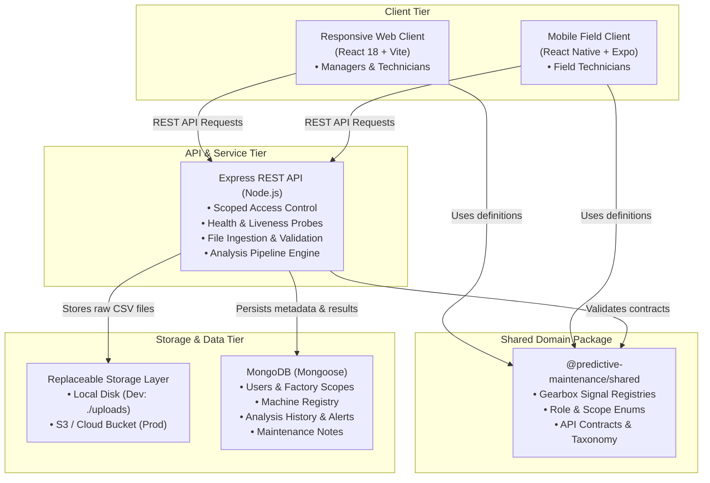

# System Architecture & Data Flow

**AI-Based Predictive Maintenance and Failure Prevention System for Mechanical Systems**  
*Initial Target Machine: Industrial Multi-Stage Gearbox*

---

## 1. High-Level System Architecture

The system is architected as a modular, full-stack JavaScript monorepo supporting dual clients (desktop/tablet web and mobile field client) sharing a unified REST API and domain package.



---

## 2. Monorepo Organization

```
Predictive_Maintenance_Failure_Prevention_System/
├── apps/
│   ├── web/                  # React + Vite web application
│   │   ├── src/              # UI components, views, hooks
│   │   ├── index.html        # Entry HTML
│   │   └── vite.config.js    # Bundler config & proxy setup
│   ├── mobile/               # React Native + Expo application
│   │   ├── App.js            # Technician-focused entry
│   │   ├── app.json          # Expo configuration
│   │   └── metro.config.js   # Monorepo Metro resolver
│   └── server/               # Express REST API
│       ├── src/config/       # Environment & MongoDB configuration
│       ├── src/routes/       # Health, auth, machine, dataset routes
│       └── src/app.js        # Express application middleware
├── packages/
│   └── shared/               # Shared domain constants & contracts
│       └── src/
│           ├── roles.js      # Role definitions and access scopes
│           ├── signals.js    # Gearbox sensor channel definitions
│           ├── alerts.js     # Severity, status, and analysis taxonomy
│           └── contracts.js  # API routes & response schemas
├── docs/                     # Engineering architecture & roadmap
├── uploads/                  # Ignored local raw file storage (dev)
└── package.json              # Monorepo npm workspace root
```

---

## 3. Security & Access Control Model

Access control is strictly enforced on the server for all REST endpoints; UI element visibility is treated as presentation only.

### User Roles
- **Factory Manager (`factory_manager`)**: Manages machines, sites, users, datasets, alerts, and executive reports within their factory scope.
- **Technician (`technician`)**: Views assigned machines, uploads operational datasets, inspects explainable warnings, acknowledges alerts, and adds maintenance logs.
- **Viewer (`viewer`)**: Read-only inspection of assigned machines and telemetry history.

### Hierarchical Scoping
All machine records, uploaded datasets, and generated alerts belong to a hierarchical scope:
$$\text{Organization} \longrightarrow \text{Factory} \longrightarrow \text{Site} \longrightarrow \text{Machine (Gearbox)}$$

Every request token validates the caller's factory and assigned machine scope before granting read or write operations.

---

## 4. Gearbox Domain & Signal Channels

The initial reference target is an **Industrial Multi-Stage Gearbox** (planetary/helical stages). Sensor channels are categorized into three decoupled functional groups:

1. **Vibration Channels (Dynamic mechanical health):**
   - Input Shaft Axial Vibration (`vibration_input_axial`, mm/s or g)
   - Input Shaft Radial Vibration (`vibration_input_radial`, mm/s or g)
   - Output Shaft Radial Vibration (`vibration_output_radial`, mm/s or g)
2. **Thermal Channels (Lubrication & friction health):**
   - Gearbox Sump Oil Temperature (`temp_gearbox_sump`, °C)
   - Drive-End Bearing Temperature (`temp_bearing_input`, °C)
3. **Operating Regime Channels (Operational context):**
   - Shaft Rotational Speed (`rotational_speed`, RPM)
   - Mechanical Load / Torque (`load_torque`, Nm)

*Architectural Principle:* Thermal and vibration channels are analyzed via distinct pathways. A thermal anomaly (e.g., loss of lubrication or cooling failure) can trigger an alert even when dynamic vibration remains within normal thresholds.

---

## 5. Replaceable Storage Layer Design

Raw dataset files (CSV) are stored outside MongoDB:
- **Local Development:** Written to `./uploads/` with UUID naming and cryptographic checksums (SHA-256).
- **Production Extension:** Handled through an abstract `FileStorageProvider` interface enabling zero-code-change migration to AWS S3 or Google Cloud Storage.
- **Database Role:** MongoDB stores dataset metadata (row count, time bounds, detected signals, validation outcomes, provenance labels), never multi-megabyte binary CSV payloads.

---

## 6. Resilience & Graceful Degradation

- **Non-blocking Database Connection:** The Express API server boots immediately and serves liveness and health checks regardless of whether MongoDB is currently reachable.
- **Detailed Health Diagnostics:** The `/api/health` endpoint exposes uptime, service status, and database connectivity state without revealing passwords, internal URLs, or credentials.

